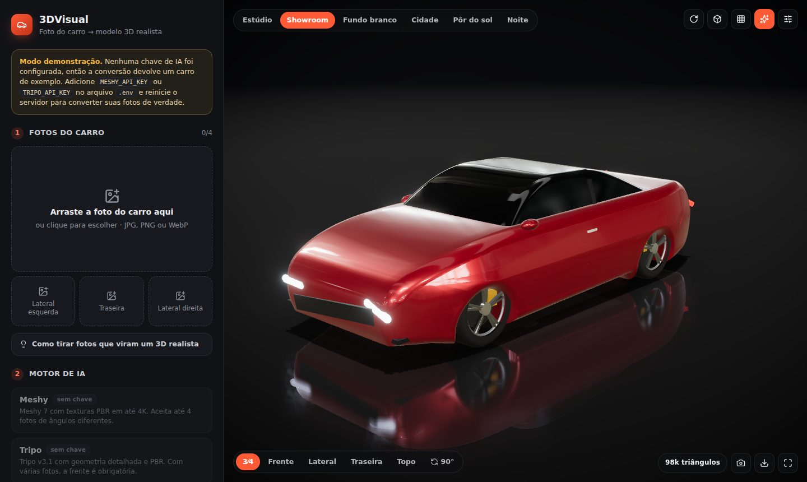

# 3DVisual — fotos de carros em modelos 3D realistas

Web app que transforma fotos de um carro em um modelo 3D texturizado (GLB com materiais PBR) usando IA de geração 3D, e mostra o resultado num visualizador com iluminação de estúdio automotivo.



> A imagem acima mostra o **carro de exemplo do modo demonstração**, um modelo procedural. Com uma chave da Meshy ou da Tripo configurada, o app gera o 3D a partir das **suas** fotos.

## O que ele faz

- **Até 4 fotos por carro** (frente/3⁄4, lateral esquerda, traseira, lateral direita). Mais ângulos dão uma geometria bem melhor nas partes que uma foto só não mostra.
- **Preparação da foto no navegador**: corrige a rotação EXIF, reduz para 2048 px e avisa se a foto estiver pequena ou desfocada.
- **Dois motores de IA**, à escolha:
  - **Meshy**: Meshy 7 (com o passo extra *Ultra*), texturas PBR e base color em 4K. Aceita de 1 a 4 fotos em qualquer ordem.
  - **Tripo**: v3.1 com geometria *detailed* e textura *extreme* + PBR. No modo multivista, a foto da frente é obrigatória.
- **Visualizador realista** (Three.js / React Three Fiber):
  - ambientes **Estúdio** (softboxes), **Showroom**, **Fundo branco** (foto de anúncio), **Cidade**, **Pôr do sol** e **Noite**;
  - piso reflexivo, sombras de contato, oclusão de ambiente (N8AO), bloom e tone mapping ACES;
  - **verniz automotivo inteligente**: adiciona clearcoat só nas áreas lisas da textura (lataria e vidros), sem deixar pneus e plásticos brilhando;
  - câmeras prontas (3⁄4, frente, lateral, traseira, topo), botão para girar 90° quando a IA orientar o carro de lado, e plataforma giratória;
  - modo argila e wireframe para conferir a geometria;
  - download do `.glb`, captura PNG e tela cheia.
- **Garagem**: histórico das gerações salvo no servidor (`data/`). Se o servidor reiniciar no meio de uma geração, ele retoma a consulta sem criar outra tarefa paga.
- **Modo demonstração**: funciona sem chave de API. Simula as etapas e devolve um carro de exemplo, para testar o fluxo inteiro.

## Como rodar

Requisitos: **Node.js 20.12 ou mais novo**.

```bash
npm install
cp .env.example .env      # depois edite o .env e cole sua chave
npm run dev
```

Abra **http://localhost:5173**. Em desenvolvimento, o Vite serve o frontend e repassa `/api` para o servidor Node (porta `8787`).

### Chaves de API

Preencha pelo menos uma no `.env` e reinicie o `npm run dev`:

| Variável | Onde conseguir |
| --- | --- |
| `MESHY_API_KEY` | https://www.meshy.ai/settings/api |
| `TRIPO_API_KEY` | https://platform.tripo3d.ai/ (chaves começam com `tsk_`) |
| `TRIPO_API_BASE` | Opcional. Use `https://openapi.tripo3d.com/v3` se sua conta Tripo for da região China. |

As chaves ficam **só no servidor**: o navegador nunca as vê.

### Custos (créditos do provedor)

Cada geração consome créditos da sua conta no provedor. Referência aproximada da Meshy: Meshy 7 com textura ≈ 30 créditos, +5 no modo *Ultra*; Meshy 5 é bem mais barato. A Tripo cobra conforme modelo e qualidade. Confira sempre a tabela de preços atual de cada serviço. O app mostra os créditos gastos quando o provedor informa.

### Produção

```bash
npm run build   # gera dist/
npm start       # API + frontend em http://localhost:8787
```

> ⚠️ O app **não tem login**. Se você publicar na internet com a sua chave configurada, qualquer pessoa poderá gastar seus créditos. Coloque-o atrás de autenticação (proxy com senha, VPN etc.) antes de expor.

## Dicas para fotos que viram um 3D realista

1. Enquadre **o carro inteiro**, sem cortar para-choques nem rodas.
2. A melhor foto única é a **3⁄4 dianteira**, na altura dos faróis.
3. Prefira **luz difusa** (dia nublado ou sombra): reflexos fortes do sol viram manchas na textura.
4. Use um **fundo limpo**, sem pessoas ou outros carros na frente.
5. Para o melhor resultado, envie **4 ângulos**: frente, as duas laterais e a traseira.

A IA reconstrói o que não aparece na foto. Com uma foto só, o lado oculto é "imaginado"; com mais ângulos, o modelo fica fiel ao carro real.

## Como funciona

```
Navegador                       Servidor (Express)                  Provedor de IA
─────────                       ──────────────────                  ──────────────
fotos → EXIF/resize (2048px) ─► POST /api/jobs ──────────────────► cria tarefa (Meshy/Tripo)
                                  salva fotos em data/jobs/<id>/
progresso ◄── GET /api/jobs ◄──── consulta o status a cada 3–5 s ◄─ PENDING / RUNNING / …
                                  ao concluir: baixa o GLB na hora
visualizador ◄─ /api/files/<id>/model.glb   (links da Tripo expiram em ~5 min)
```

```
server/
  index.ts              rotas HTTP, upload (multer), arquivos estáticos
  jobs.ts               fila de gerações, polling, download, persistência em data/jobs.json
  providers/meshy.ts    image-to-3d e multi-image-to-3d (API v1)
  providers/tripo.ts    upload + image-to-model / multiview-to-model (API v3)
  providers/demo.ts     modo demonstração
  assets/demo-car.glb   carro de exemplo (gerado por scripts/build-demo-car.ts)
shared/types.ts         tipos usados pelo servidor e pelo frontend
src/
  App.tsx               tela principal: fotos, motor de IA, geração, garagem
  components/viewer/    visualizador 3D (Canvas, ambientes, modelo, câmeras)
  lib/image.ts          preparo das fotos no navegador
  lib/materials.ts      PBR → material físico com verniz, normalização de escala
tests/                  testes (Vitest) dos provedores e da fila
```

## Scripts

| Comando | O que faz |
| --- | --- |
| `npm run dev` | API + frontend com recarregamento automático |
| `npm run build` | build de produção do frontend |
| `npm start` | servidor de produção (serve também o `dist/`) |
| `npm test` | testes automatizados |
| `npm run typecheck` | checagem de tipos do TypeScript |
| `npm run demo-car` | regenera o carro de exemplo `server/assets/demo-car.glb` |
